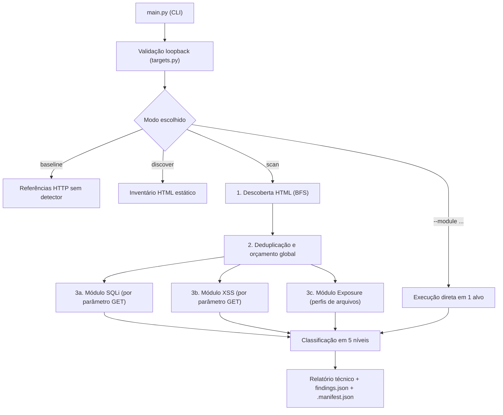

# ProbeKit

Scanner acadêmico de aplicações web locais, desenvolvido para **SIN 451 — Segurança da Informação (UFV)**. Realiza descoberta HTML estática e análise de **SQL Injection**, **XSS refletido** e **exposição de arquivos sensíveis**, gerando relatórios JSON verificáveis com evidências e limites explícitos.

> **Escopo seguro por construção:** o ProbeKit atua exclusivamente em `localhost` / IPs loopback, envia apenas requisições `GET`, não segue redirecionamentos e não executa autenticação, escrita ou exploração destrutiva.

---

## 1. Propósito e diferencial

Ferramentas comuns de varredura costumam responder apenas *"vulnerável"* ou *"não vulnerável"* com base em assinaturas isoladas ou simples mudanças de resposta — o que gera muitos falsos positivos e obriga triagem manual.

O ProbeKit existe para **classificar com evidência**:

* **Detecção diferencial com controles negativos:** compara respostas de referência (*baseline*), sondas de ataque e controles negativos (entradas que não devem disparar a vulnerabilidade).
* **Confirmação rigorosa:** a classe `confirmed` só é atribuída quando **todos** os critérios e controles do módulo são satisfeitos.
* **Abstenção explícita:** quando faltam dados, controles ou estabilidade, a ferramenta declara `suspected` ou `inconclusive` em vez de arriscar um palpite.
* **Privacidade e auditabilidade:** relatórios usam hashes estruturais (sem persistir corpos HTTP, cookies ou segredos encontrados) e contam com manifesto SHA-256 para verificação offline.

Na [avaliação experimental](docs/RESULTADOS_EXPERIMENTAIS.md), uma heurística simples ("a resposta mudou em relação à referência") gerou **39 falsos positivos** em exposição, **18** em SQLi e **15** em cada condição de XSS nos casos seguros; sobre as mesmas evidências, o ProbeKit produziu **zero falsos positivos confirmados**.

### O que o ProbeKit NÃO é

Não substitui `sqlmap`, OWASP ZAP ou Burp Suite. Por decisão de projeto, opera somente via `GET`, não testa alvos externos, não faz login/sessão, não extrai dados de banco e não executa JavaScript durante a descoberta de rotas.

---

## 2. Visão geral do funcionamento

No modo integrado (`scan`), todos os módulos compartilham um único cliente HTTP (`ScopedHttpClient`), a mesma origem autorizada e o mesmo orçamento global de requisições:



### Modos disponíveis na CLI

| Comando / Modo | O que faz |
| --- | --- |
| `main.py URL` (padrão `baseline`) | Coleta referências HTTP e compara estabilidade sem enviar sondas de ataque. |
| `main.py discover URL` | Mapeia links e formulários `GET` em HTML estático (inventário sem ataques). |
| `main.py URL --module sqli \| xss \| exposure` | Executa apenas um detector diretamente sobre a URL informada. |
| `main.py scan URL` | Integra descoberta automática + seleção/deduplicação + detectores escolhidos (`--modules`). |
| `main.py verify-report MANIFESTO` | Verifica offline a integridade (hashes SHA-256) entre relatório técnico e `findings.json`. |

---

## 3. Como interpretar as classificações

Cada parâmetro analisado (SQLi/XSS) ou arquivo consultado (Exposure) recebe exatamente uma de cinco classificações:

| Classe | Significado |
| --- | --- |
| `confirmed` | **Todos** os critérios do módulo foram satisfeitos, incluindo controles negativos e estabilidade. |
| `suspected` | Há indício específico (erro SQL, par booleano coerente ou reflexão executável), mas faltou controle ou confirmação final. |
| `inconclusive` | Coleta incompleta, respostas instáveis, página de erro ou formato incompatível; não é possível concluir. |
| `not_detected` | As sondas executadas não demonstraram a falha; **não** prova ausência de vulnerabilidade. |
| `reflected_safe` | *(Apenas XSS)* A entrada foi refletida, mas em contexto inerte ou com caracteres críticos escapados. |

---

## 4. Como o ProbeKit encontra cada falha

### 4.1 Descoberta HTML (`discover`)

Implementada em [scanner/discovery.py](scanner/discovery.py):
* Faz busca em largura (BFS) dentro da **mesma origem** (esquema, host e porta), respeitando `--max-depth` (padrão `2`) e `--max-pages` (padrão `20`).
* Extrai links (`<a>`) e formulários `GET` (`<form>`) do HTML estático.
* **Regra de segurança/precisão:** campos de formulários que não trazem valor de referência ficam registrados no inventário, mas são **ignorados** na etapa de análise (`form_reference_values_unavailable`), pois o scanner não inventa dados.

### 4.2 SQL Injection (`sqli`)

Implementado em [scanner/sqli_plans.py](scanner/sqli_plans.py), [scanner/sqli_features.py](scanner/sqli_features.py) e [scanner/sqli_classification.py](scanner/sqli_classification.py).

Para cada parâmetro `GET` (valor de referência `t` com 1–80 caracteres), envia `samples + 8` requisições (10 no padrão), alterando **apenas** esse parâmetro:

| Etapa / Papel | Valor enviado | Função na análise |
| --- | --- | --- |
| `baseline_1..N` | `t` | Verifica se a resposta normal é não vazia e estável. |
| `quote` | `t'` | Tenta provocar erro de sintaxe SQL (assinatura SQLite/Sequelize + status ≥ 400). |
| `escaped_quote` | `t''` | **Controle negativo:** aspa escapada não deve quebrar nem retornar os mesmos registros de `t`. |
| `literal_control` | `t AND 17=17` | **Controle negativo:** sem fechar aspas, deve ser tratado como texto literal e retornar vazio. |
| `true_17` / `false_17` | Contexto `like`: `t%' AND (17=17) AND '%' LIKE '%` vs `(17=18)`<br>Contexto `quoted`: `t' AND (17=17) AND 'x'='x` vs `(17=18)` | **1.º par booleano:** condição verdadeira deve igualar a `baseline`; condição falsa deve retornar vazio. |
| `true_23` / `false_23` | Mesma estrutura com `23=23` e `23=24` | **2.º par booleano:** replica o teste para eliminar coincidências. |
| `recovery` | `t` | Confirma que a aplicação voltou ao estado original após as sondas. |

* **Comparação estrutural sem guardar conteúdo:** em respostas JSON, ordena IDs únicos (`id`, `sku`, `code`) ou canonicaliza os itens; em HTML/texto, extrai o texto visível normalizado (sem `<script>`/`<style>`). Apenas hashes SHA-256 dessas características são comparados.
* **Decisão:** `confirmed` exige todas as 10 checagens aprovadas (baseline estável, controles vazios, erro SQL novo na sonda `quote`, dois pares booleanos coerentes, respostas falsas estáveis entre si e recuperação idêntica). Se houver só erro SQL diferencial ou um par booleano coerente, classifica como `suspected`.

### 4.3 XSS Refletido (`xss`)

Implementado em [scanner/modules/xss.py](scanner/modules/xss.py), [scanner/xss_analysis.py](scanner/xss_analysis.py) e [scanner/xss_browser.py](scanner/xss_browser.py).

Para cada parâmetro `GET`, gera um marcador exclusivo (`WVX` + 24 hexadecimais) e um nome de função inofensivo (`wvxss_<hex>`), enviando até `samples + 8` requisições:

1. **`baseline_1..N`:** garante que a página responde normalmente e não contém o marcador.
2. **`marker_1` e `marker_2`:** duas sondas independentes com marcadores distintos. Se nenhuma refletir, o scanner encerra cedo as sondas de ataque e vai direto para `recovery` (`not_detected`).
3. **`escape` (`<marcador><>&"'<marcador>END`):** mede se `<`, `>`, `&`, `"` e `'` voltam literais, escapados como entidade HTML (`&lt;`, etc.) ou removidos.
4. **4 sondas com callback inofensivo** `globalThis.wvxss_<hex>(...)`: cobrem quebra de tag (`attack_html`), saída de atributo (`attack_attribute`) e strings JavaScript (`attack_single`, `attack_double`), seguidas de `recovery`.
5. **Análise de contexto (`ReflectionParser`):** classifica onde a entrada apareceu (`script`, `event_handler`, `url_attribute`, `css`, `html_text`, `html_comment`, `inert_template`, `json`, etc.).
6. **Confirmação opcional em navegador (`--xss-browser`):** aciona [scripts/confirm-xss.mjs](scripts/confirm-xss.mjs) com Edge/Chrome em perfil temporário isolado. O navegador **não refaz requisições ao servidor**: faz *replay* local dos bytes já recebidos (`marker_1` como controle negativo + sondas `attack_*`), mantendo a CSP e com **toda a rede bloqueada**, apenas observando se o callback dispara.

* **Decisão:** `confirmed` exige contexto potencialmente executável **e** execução observada no navegador (com controle negativo limpo). Sem navegador, o máximo possível é `suspected`. Se refletiu apenas em contexto inerte ou com escape adequado, vira `reflected_safe`.

### 4.4 Exposição de Arquivos (`exposure`)

Implementado em [scanner/exposure_profiles.py](scanner/exposure_profiles.py) e [scanner/exposure_analysis.py](scanner/exposure_analysis.py).

Em vez de *brute-force* livre, consulta apenas um **catálogo fechado** de até 5 caminhos a partir do diretório-base informado (`/` por padrão, ou `--exposure-base-path`):

| Perfil | Caminhos verificados | Assinatura estrutural esperada |
| --- | --- | --- |
| `config` *(padrão)* | `.env`, `config.ini` | ≥ 2 atribuições `CHAVE=valor` com indicador de credencial (`PASSWORD`, `SECRET`, `TOKEN`, `_KEY`) ou banco (`DB_`, `DATABASE_`, `[database]`). |
| `backup` | `backup.sql`, `config.ini.bak` | `CREATE TABLE` + `INSERT INTO` (SQL) ou estrutura de configuração (`.bak`). |
| `repository` | `.git/HEAD` | Referência Git (`ref: refs/heads/...` ou hash SHA-1/SHA-256). |

Para cada arquivo, envia **4 requisições `GET`**:
* `control_1` e `control_2`: caminhos aleatórios inexistentes no mesmo diretório (`/.probekit-missing-<hex>-<arquivo>`), para detectar servidores ou SPAs que retornam HTTP 200 genérico (*fallback*) para qualquer URL.
* `reference_1` e `reference_2`: requisições ao arquivo real.

* **Decisão:** `confirmed` exige HTTP 200 estável nas duas referências, assinatura estrutural compatível, **não** parecer HTML, página de erro ou documento público (`README`, `LICENSE`), e resposta **diferente** dos dois controles inexistentes. Valores e segredos encontrados **nunca** são gravados no relatório.

---

## 5. Relatórios, privacidade e códigos de saída

Cada execução gera três arquivos no diretório de `--output` (padrão `reports/<modo>-<UTC>.json`):

1. **Relatório técnico (`<nome>.json`):** registra parâmetros descobertos, alvos ignorados (com motivo), requisições por ID, critérios (`checks`) de cada módulo, limitações, `collection_status` (`running`, `completed`, `limited`, `incomplete`, `interrupted`) e `analysis_summary`.
2. **Resumo de achados (`findings.json`):** contém apenas itens `confirmed` e `suspected` deduplicados por módulo/URL/parâmetro/status (ou `findings-summary.json` se o arquivo principal já se chamar `findings.json`).
3. **Manifesto (`<nome>.json.manifest.json`):** vincula a dupla por `run_id`, `snapshot_id` e hashes SHA-256, verificável com `main.py verify-report`.

### Perfis de evidência (`--evidence-profile`)

* **`shareable` *(padrão)*:** anonimiza URLs, caminhos e parâmetros por IDs opacos e omite payloads, textos livres e cabeçalhos técnicos.
* **`restricted`:** preserva detalhes de reprodução com permissões restritas de arquivo e mascaramento de credenciais/valores sensíveis. *Revisar antes de compartilhar.*
* **Em todos os perfis:** corpos HTTP, cookies, cabeçalhos de autenticação e valores/chaves encontrados por `exposure` **nunca** são persistidos.

### Códigos de saída

| Código | Significado |
| --- | --- |
| `0` | Execução concluída ou limitada pelo orçamento sem falhas de transporte/processamento. |
| `1` | Falha HTTP de transporte/tamanho, erro de gravação, exceção de execução ou análise `inconclusive`. |
| `2` | Argumentos inválidos ou alvo fora do escopo loopback bloqueado antes da execução. |
| `130` | `scan` interrompido com `Ctrl+C` (salva checkpoint parcial quando possível). |

---

## 6. Garantias de transporte e limitações reais

* **Confinamento e transporte:** `localhost` é normalizado para `127.0.0.1`; proxies e credenciais do ambiente são ignorados; cookies não são reutilizados; TLS é verificado.
* **Limites operacionais:** `--timeout 5` (inatividade), `--interval 0.2` (entre requisições), `--max-body-bytes 1048576` (1 MiB por resposta), `--request-deadline 15` (limite total por GET em worker isolado), `--max-urls 1000`, `--max-candidates 2000`, `--max-url-length 8192`, `--max-metadata-bytes 8388608` e `--max-total-body-bytes 33554432`. Orçamento insuficiente ignora alvos com justificativa no JSON em vez de convertê-los em negativos.
* **Limitações dos detectores:**
  * **Descoberta:** HTML estático; aplicações SPA montadas via JavaScript (como APIs do Juice Shop) têm baixa visibilidade automática.
  * **SQLi:** cobre apenas parâmetros `GET` em contexto textual entre aspas simples (`like`/`quoted`); não testa SQLi numérico, temporal (*time-based*), `UNION` ou outros SGBDs além das assinaturas tratadas.
  * **XSS:** cobre apenas XSS refletido `GET`; não testa XSS armazenado nem DOM XSS; sem Node + Edge/Chrome não confirma execução. Há um falso positivo de `suspected` documentado em string JavaScript devidamente escapada (o navegador não executa, mantendo a proteção contra falso `confirmed`).
  * **Exposure:** limitado aos 5 caminhos dos 3 perfis; comprova acesso e estrutura, não se os segredos são válidos ou se o arquivo deveria ser público.

---

## 7. Estrutura do repositório

| Caminho | Conteúdo |
| --- | --- |
| [main.py](main.py) | Ponto de entrada da CLI (`baseline`, `discover`, `scan`, `verify-report`). |
| [scanner/](scanner/) | Núcleo do scanner: validação loopback (`targets.py`), cliente HTTP e worker (`http_client.py`, `transport*.py`), descoberta (`discovery.py`), pipeline (`pipeline.py`), detectores (`modules/`, `sqli_*.py`, `xss_*.py`, `exposure_*.py`), privacidade e relatórios (`privacy.py`, `reporter.py`, `findings_report.py`). |
| [experiments/](experiments/) | Laboratórios locais fictícios com gabarito (incluindo `sqlite_control.py`, `xss_lab.py`, `exposure_lab.py`) e scripts da campanha experimental (`experiments/evaluation/`). |
| [scripts/](scripts/) | Helper de replay XSS em navegador (`confirm-xss.mjs`) e scripts auxiliares de ambiente/Juice Shop. |
| [lab/](lab/) | Documentação e arquivos do alvo adicional opcional OWASP Juice Shop ([lab/README.md](lab/README.md)). |
| [tests/](tests/) | Suíte automatizada `pytest` cobrindo contratos de CLI, descoberta, SQLi, XSS (inclusive navegador real), exposure, privacidade, limites e integridade de relatórios. |
| [docs/](docs/) | Documentação técnica completa do projeto ([índice](docs/README.md)). |

---

## 8. Instalação, demonstração rápida e testes (Windows 11)

### Requisitos e ambiente

* **Obrigatórios:** Python 3.13 (`requests==2.34.2`, `pytest==8.4.2`).
* **Opcionais:** Node.js 24 e Edge/Chrome instalados para confirmação XSS via `--xss-browser`.

```powershell
py -3.13 -m venv .venv
.\.venv\Scripts\python.exe -m pip install -r requirements-dev.txt
.\.venv\Scripts\python.exe -m pip check
.\.venv\Scripts\python.exe main.py --help
```

*(Para apenas executar o scanner sem `pytest`, use `requirements.txt`. Se `py` não existir, use `python -m venv .venv`.)*

### Demonstração com o laboratório local

O servidor `experiments.sqlite_control` simula rotas vulneráveis e rotas seguras de controle (usando apenas dados fictícios em SQLite em memória/local, sem Docker).

**Terminal 1** (sobe o laboratório na porta `8005`):

```powershell
.\.venv\Scripts\python.exe -m experiments.sqlite_control --port 8005
```

**Terminal 2** (executa o scan integrado com os três módulos):

```powershell
$env:PYTHONUTF8 = '1'
.\.venv\Scripts\python.exe main.py scan http://127.0.0.1:8005/probekit-lab --modules sqli xss exposure --exposure-profiles config backup --xss-browser --max-requests 100 --output reports/demo/three-modules.json
```

Exemplos de uso direto por módulo:

```powershell
# Apenas descoberta HTML
.\.venv\Scripts\python.exe main.py discover http://127.0.0.1:8005/probekit-lab --output reports/demo/discovery.json

# SQLi direto (vulnerável vs controle seguro)
.\.venv\Scripts\python.exe main.py "http://127.0.0.1:8005/general/json/vulnerable?term=apple&lang=en" --module sqli --parameter term --output reports/demo/sqli.json
.\.venv\Scripts\python.exe main.py "http://127.0.0.1:8005/general/json/safe?term=apple&lang=en" --module sqli --all-parameters --max-requests 20 --output reports/demo/sqli-safe.json

# XSS direto (vulnerável com navegador vs controle escapado)
.\.venv\Scripts\python.exe main.py "http://127.0.0.1:8005/xss/html/raw?q=demo" --module xss --xss-browser --output reports/demo/xss.json
.\.venv\Scripts\python.exe main.py "http://127.0.0.1:8005/xss/html/escaped?q=demo" --module xss --output reports/demo/xss-safe.json

# Exposure direto e verificação offline do manifesto
.\.venv\Scripts\python.exe main.py http://127.0.0.1:8005/ --module exposure --exposure-profiles config backup --max-requests 16 --output reports/demo/exposure.json
.\.venv\Scripts\python.exe main.py verify-report reports/demo/three-modules.json.manifest.json
```

*(Dica no PowerShell: URLs com `&` devem ficar entre aspas.)*

### Principais opções da CLI

| Opção | Uso e padrão |
| --- | --- |
| `--module` / `--modules` | `baseline`, `sqli`, `xss`, `exposure` (no `scan`, padrão apenas `sqli`). |
| `--parameter` / `--all-parameters` | Seleciona um ou todos os parâmetros `GET` (preserva os demais na query). |
| `--sqli-context` | `like` (padrão) ou `quoted` (igualdade entre aspas simples). |
| `--xss-browser` | Ativa confirmação de XSS via replay local isolado em navegador. |
| `--exposure-profiles` | `config` (padrão), `backup`, `repository`. |
| `--exposure-base-path` | Diretório-base para `exposure` no `scan` (padrão `/`). |
| `--samples` / `--max-requests` | Referências por análise (padrão `2`) e orçamento (`10` direto, `20` `discover`, `100` `scan`). |
| `--evidence-profile` | `shareable` (padrão anonimizado) ou `restricted` (com detalhes de reprodução). |
| `--output` | Caminho do relatório JSON técnico (`findings.json` e `.manifest.json` são gerados juntos). |

### Suíte de testes automatizados

Os testes usam servidores loopback efêmeros locais (sem depender de rede externa ou do Juice Shop):

```powershell
.\.venv\Scripts\python.exe -m pytest -q
```

Para reproduzir a suíte completa de avaliação experimental (que inclui geração de gráficos com Matplotlib em ambiente isolado `.venv-evaluation`), consulte [experiments/evaluation/README.md](experiments/evaluation/README.md). Detalhes do alvo opcional Juice Shop estão em [lab/README.md](lab/README.md).

---

## 9. Documentação complementar

* **Para entender e avaliar o projeto:** [Propósito e diferencial](docs/PROPOSITO_E_DIFERENCIAL.md) · [Arquitetura](docs/ARQUITETURA.md) · [Modelo de detecção](docs/MODELO_DE_DETECCAO.md) · [Resultados experimentais](docs/RESULTADOS_EXPERIMENTAIS.md) · [Comparação com sqlmap e ZAP](docs/COMPARACAO_FERRAMENTAS.md)
* **Segurança e análise de ameaças:** [Impacto e mitigação](docs/IMPACTO_E_MITIGACAO.md) · [Detectabilidade e regras de IDS](docs/DETECTABILIDADE_IDS.md)
* **Roteiros e detalhes por módulo:** [Demonstração curta](docs/DEMONSTRACAO.md) · [Descoberta](docs/DESCOBERTA.md) · [SQLi](docs/SQLI_GENERALIZADO.md) · [XSS](docs/XSS_REFLETIDO.md) · [Exposure](docs/EXPOSICAO_ARQUIVOS.md) · [Testes](docs/TESTES.md) · [Índice completo](docs/README.md)

*(Nota: o repositório ainda não possui arquivo de licença definido.)*
