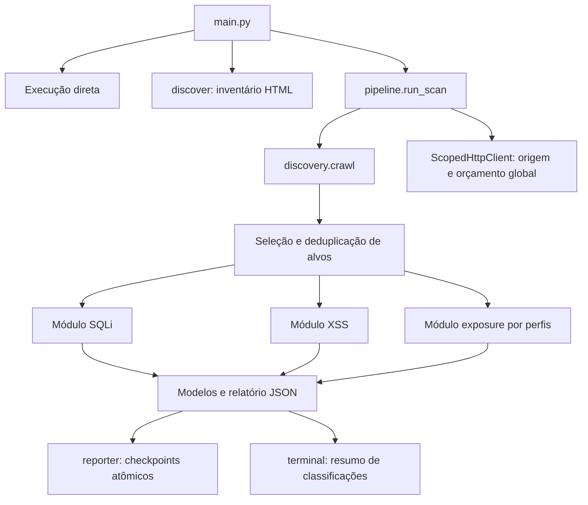

# Arquitetura do ProbeKit

`main.py` valida argumentos e chama o modo solicitado. A CLI anterior continua
disponível: baseline, `discover`, SQLi/XSS/exposure diretos e `scan`. Nenhum
critério de detecção foi alterado na etapa de preparação para publicação.

O diagrama representa o fluxo de controle. Os três módulos recebem o mesmo
cliente HTTP no scan; não criam orçamentos independentes. A descoberta ocorre
antes das análises. Exposure é planejado uma vez por catálogo/diretório-base,
depois dos parâmetros, sem depender de encontrar links para arquivos ocultos.

| Camada | Arquivos e responsabilidades |
| --- | --- |
| CLI | `main.py`: argumentos, saída no terminal, caminhos de relatório e códigos de saída |
| Escopo e transporte | `targets.py`, `http_client.py`: somente loopback, GET, timeout, intervalo, bytes, sem redirects/cookies/proxies do ambiente |
| Descoberta | `discovery.py`: parser HTML padrão, fila em largura, normalização, links/formulários GET, parâmetros e proveniência |
| Integração | `pipeline.py`: mesma origem, IDs, orçamento global, deduplicação, ignorados, interrupção e checkpoints |
| SQLi | `sqli_plans.py`: planos; `modules/sqli.py`: execução; `sqli_features.py`: características; `sqli_classification.py`: decisão |
| XSS | `query.py`: manipulação GET; `modules/xss.py`: marcadores e execução; `xss_analysis.py`: contexto/escape/decisão; `xss_browser.py` e `scripts/confirm-xss.mjs`: confirmação isolada opcional |
| Exposure | `exposure_profiles.py`: catálogo; `modules/exposure.py`: execução; `exposure_analysis.py`: estrutura e decisão; `exposure_models.py`: evidência mínima sem conteúdo |
| Dados e saída | `models.py`: contratos; `reporter.py`: JSON/checkpoints; `terminal.py`: contagem das avaliações já classificadas |
| Referências HTTP | `core.py`, `analyzer.py`: baseline e comparação observacional; similaridade sozinha não confirma vulnerabilidade |
| Validação | `experiments/`: servidores e rodadas fictícios; `tests/`: contratos, processos CLI, HTTP/SQLite e navegador real |

## Contratos do scan

Os alvos de parâmetros são deduplicados por URL canônica, parâmetro, módulo e
contexto; valores GET distintos continuam sendo referências distintas. Cada
teste preserva os outros tokens da query. Campos de formulário sem valor de
referência não são submetidos: ficam no inventário e nos motivos de exclusão.
Os alvos exposure têm origem `configured_profile`, sem parâmetro GET.

O orçamento conta tentativas de GET, incluindo falhas/interrupções após a
reserva do ID. Antes de uma análise, o saldo deve comportar o plano máximo:
`samples + 8` por parâmetro SQLi/XSS e `samples + 2` por arquivo exposure.
Replays XSS usam bytes já recebidos, com CSP preservada, perfil temporário e
bloqueio da rede; não repetem GETs ao alvo. Não usam o perfil do usuário.

`parameter_results` e `exposure_results` são os resultados individuais. O
resumo de terminal conta esses resultados, sem recalcular classificações nem
inferi-las a partir de `findings` ou do HTTP 200. Uma única vulnerabilidade
pode ter diversas requisições de evidência; elas não são achados separados.
`reflected_safe` permanece distinto de `not_detected`. Alvos ignorados ou
análises sem classificação não são transformados em controles negativos.

O JSON preserva estado, critérios, evidências por ID e limitações. Os corpos
não são serializados; exposição usa objetos que sequer possuem atributo de
corpo ou cabeçalho arbitrário. URLs, payloads e cabeçalhos técnicos dos demais
módulos precisam de revisão antes de compartilhamento. A substituição atômica
do checkpoint protege o relatório anterior quando a nova escrita falha.

## Escopo empírico

HTML estático não descobre automaticamente APIs montadas por JavaScript.
SQLi cobre contextos textuais restritos; XSS depende de evidência real do
navegador para confirmação; exposure cobre cinco nomes e estruturas textuais
selecionadas. Nenhum resultado negativo garante segurança geral.
Os critérios e falsos positivos conhecidos estão nos roteiros de
[SQLi](SQLI_GENERALIZADO.md), [XSS](XSS_REFLETIDO.md) e
[exposure](EXPOSICAO_ARQUIVOS.md).
