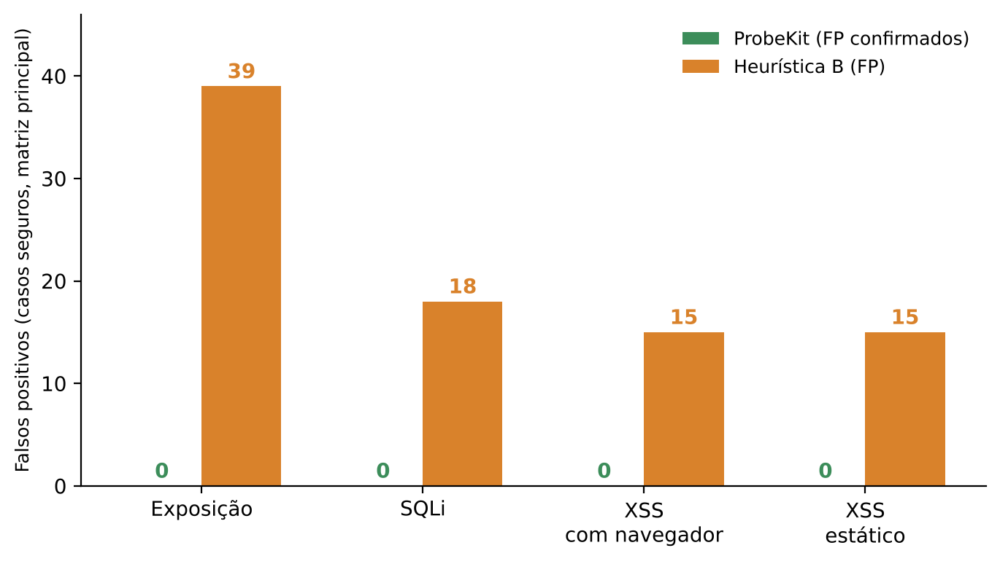

> Este documento reproduz seções do **relatório técnico** do trabalho (`RELATORIO_TECNICO.docx`). Referências do tipo "Seção N" apontam para as seções do relatório.

# 9. Comparação com outras ferramentas

## 9.1 Comparação qualitativa

A tabela compara o ProbeKit com duas ferramentas de referência indicadas no enunciado (sqlmap e OWASP ZAP) e com a heurística simples usada como linha de base na campanha. As descrições das ferramentas externas seguem a documentação pública; confirme os detalhes na versão que for usada.

| Aspecto | ProbeKit | sqlmap | OWASP ZAP | Heurística B (linha de base) |
| --- | --- | --- | --- | --- |
| Objetivo | classificar com evidência e abstenção; didático, em loopback | detectar e explorar SQLi automaticamente | plataforma de teste de aplicações web: proxy, descoberta e varredura passiva e ativa | referência para comparação (não é uma ferramenta) |
| Falhas cobertas | SQLi, XSS refletido e exposição de 5 arquivos | SQLi | várias classes, incluindo SQLi e XSS | qualquer mudança na resposta |
| Entradas | parâmetros GET | GET, POST, cookies e cabeçalhos | requisições rastreadas ou interceptadas, vários métodos | GET |
| Técnicas de SQLi | booleana e erro SQL diferencial, com controles | booleana cega, temporal, por erro, UNION, empilhada e fora de banda | regras de varredura ativa | não se aplica |
| Extração de dados | não, por projeto | sim, quando configurado (enumeração e *dump*) | não é o foco | não |
| Autenticação e sessão | não | cookies e cabeçalhos | contextos, usuários e sessões | não |
| Saída | 5 classes, critérios (`checks`) e limitações por alvo | parâmetro injetável, técnica e *payload* | alertas com risco e confiança | positivo ou negativo, sem confirmação |
| Abstenção explícita | sim (`suspected`, `inconclusive`) | não como classe dedicada | níveis de confiança, não classe de abstenção | não |
| Escopo e segurança | somente loopback, por construção | sem restrição de alvo; exige autorização do operador | sem restrição de alvo; exige autorização do operador | não se aplica |
| Custo em requisições | fixo: 10 por parâmetro de SQLi, 4 por arquivo | varia com `--level` e `--risk` (medir) | varia com a política de varredura (medir) | nenhuma extra (reaproveita a evidência coletada) |

## 9.2 Comparação empírica já realizada: ProbeKit contra a heurística simples

A campanha formal comparou o ProbeKit (A) com uma heurística (B) que marca como positivo qualquer resposta cujo status, tamanho ou *hash* difira da primeira referência. As duas usam exatamente a mesma evidência coletada, e B não vê nome de caso, gabarito nem classificação.

| Grupo | Acertos A | FP A | FN A | Suspeitos ou inconclusivos A | Acertos B | FP B | FN B |
| --- | ---: | ---: | ---: | ---: | ---: | ---: | ---: |
| Exposição, principal | 75 | 0 | 0 | 0 | 36 | 39 | 0 |
| SQLi, principal | 36 | 0 | 0 | 0 | 18 | 18 | 0 |
| XSS com navegador, principal | 24 | 0 | 0 | 3 | 12 | 15 | 0 |
| XSS estático, principal | 15 | 0 | 0 | 12 | 12 | 15 | 0 |



A heurística nunca perde uma vulnerabilidade (FN igual a zero), mas marca como positiva quase toda variação, inclusive as de casos seguros. O ProbeKit não produziu falsos positivos confirmados, mas **retém suspeitas** (por exemplo, o caso X06) e, sem navegador, não confirma nenhum XSS. A diferença é compatível com a utilidade dos critérios completos, **sem** provar que apenas os controles negativos a causaram. A heurística B também não representa um scanner comercial: por isso a comparação com ferramentas reais, a seguir, é necessária.

## 9.3 Comparação empírica com sqlmap e ZAP

**Protocolo.** Mesmos alvos e mesmos casos para todas as ferramentas (15 casos dos laboratórios: 8 de SQLi, 6 de XSS e 1 de exposição), com todo o tráfego passando por um proxy de registro em loopback que conta as requisições de forma idêntica para cada ferramenta (`experiments/comparison/logproxy.py`). O sqlmap roda apenas para detecção (sem `--dump`), com a configuração padrão e com `--level 5 --risk 3`; o ZAP roda a varredura rápida com a política padrão. Registram-se a versão de cada ferramenta, o resultado por caso (detectou ou não, e o que foi alegado) e o número de requisições. Os comandos exatos estão em `docs/COMPARACAO_FERRAMENTAS.md`.

**Resultados do ProbeKit** (execução de referência com `experiments/comparison/run_probekit_cases.py`, ambiente Linux, Python 3.12, **sem navegador**: por isso os XSS vulneráveis aparecem como `suspected`; com `--xss-browser` a campanha formal confirmou 9 de 9). As células amarelas `[…]` (colunas do sqlmap e do ZAP) devem ser preenchidas após executar o protocolo: resultado por caso (`detectou` ou `não detectou`) e número de requisições medido pelo proxy.

| Caso | Gabarito | ProbeKit | Req. | sqlmap | Req. | ZAP | Req. |
| --- | --- | --- | ---: | --- | ---: | --- | ---: |
| S01 JSON, LIKE | vulnerável | `confirmed` | 10 | **[…]** | **[…]** | **[…]** | **[…]** |
| S02 JSON, parametrizado | seguro | `not_detected` | 10 | **[…]** | **[…]** | **[…]** | **[…]** |
| S03 HTML, LIKE | vulnerável | `confirmed` | 10 | **[…]** | **[…]** | **[…]** | **[…]** |
| S04 HTML, parametrizado | seguro | `not_detected` | 10 | **[…]** | **[…]** | **[…]** | **[…]** |
| S05 texto, LIKE | vulnerável | `confirmed` | 10 | **[…]** | **[…]** | **[…]** | **[…]** |
| S06 texto, parametrizado | seguro | `not_detected` | 10 | **[…]** | **[…]** | **[…]** | **[…]** |
| S07 igualdade entre aspas | vulnerável | `confirmed` | 10 | **[…]** | **[…]** | **[…]** | **[…]** |
| S08 igualdade, parametrizado | seguro | `not_detected` | 10 | **[…]** | **[…]** | **[…]** | **[…]** |
| X01 texto HTML sem escape | vulnerável | `suspected` | 10 | n/a (só SQLi) | n/a | **[…]** | **[…]** |
| X02 texto HTML escapado | seguro | `reflected_safe` | 10 | n/a (só SQLi) | n/a | **[…]** | **[…]** |
| X03 atributo sem escape | vulnerável | `suspected` | 10 | n/a (só SQLi) | n/a | **[…]** | **[…]** |
| X04 atributo escapado | seguro | `reflected_safe` | 10 | n/a (só SQLi) | n/a | **[…]** | **[…]** |
| X05 script sem escape | vulnerável | `suspected` | 10 | n/a (só SQLi) | n/a | **[…]** | **[…]** |
| X06 script escapado | seguro | `suspected` | 10 | n/a (só SQLi) | n/a | **[…]** | **[…]** |
| E01 raiz: .env e backup.sql expostos; config.ini e .bak não | 2 vulneráveis, 2 seguros | `confirmed (2 confirmed, 2 not_detected)` | 16 | n/a (só SQLi) | n/a | **[…]** | **[…]** |

**Como interpretar.** Para cada caso, comparar acertos, falsos positivos e falsos negativos; o custo em requisições; o tipo de evidência produzida (o sqlmap informa técnica e *payload*; o ZAP, risco e confiança; o ProbeKit, critérios e limitações); e o tratamento dos casos difíceis (X06, instabilidade e página de erro). Os resultados valem para estes laboratórios e não se generalizam.


## 9.4 Procedimento passo a passo

Pré-requisitos: sqlmap e ZAP instalados, laboratório rodando (`python -m experiments.sqlite_control --port 8005`). **Anote a versão de cada ferramenta** (`sqlmap --version`; versão exibida pelo ZAP) e o ambiente. Tudo é feito em loopback, nos laboratórios do repositório.

**Passo 1. ProbeKit (coluna já pronta, refaça no seu computador).**

```
python -m experiments.comparison.run_probekit_cases --xss-browser
```

Gera `reports/comparacao/probekit/probekit_resultados.csv` (resultado, requisições e tempo por caso). Sem `--xss-browser`, os XSS vulneráveis saem como `suspected`.

**Passo 2. sqlmap, casos S01 a S08.** Para cada caso, em dois terminais:

```
# terminal A: proxy que conta as requisições deste caso
python -m experiments.comparison.logproxy --listen 8006 --upstream http://127.0.0.1:8005 --log reports/comparacao/sqlmap/S01.jsonl

# terminal B: sqlmap só para detecção (sem --dump), saída guardada
sqlmap -u "http://127.0.0.1:8006/general/json/vulnerable?term=apple&lang=en" -p term --batch --flush-session --dbms=SQLite > reports/comparacao/sqlmap/S01-padrao.txt
```

Repita com a configuração agressiva acrescentando `--level 5 --risk 3` (pode levar vários minutos nos casos seguros). Ao terminar, encerre o proxy (Ctrl+C) e rode `python -m experiments.comparison.summarize_log reports/comparacao/sqlmap/S01.jsonl` para obter o número de requisições e a duração.

| Caso | Caminho (porta 8006) | `-p` |
| --- | --- | --- |
| S01, S02 | `/general/json/vulnerable` e `/general/json/safe` com `?term=apple&lang=en` | `term` |
| S03, S04 | `/general/html/vulnerable` e `/general/html/safe` com `?search=apple&lang=en` | `search` |
| S05, S06 | `/general/text/vulnerable` e `/general/text/safe` com `?keyword=apple&lang=en` | `keyword` |
| S07, S08 | `/general/quoted/vulnerable` e `/general/quoted/safe` com `?item=Apple+Demo` | `item` |

**Como ler o resultado do sqlmap:** a saída com `Parameter: ... (GET)` e `Type: ...` indica que ele considerou o parâmetro injetável (registre o tipo); a mensagem de que nenhum parâmetro testado parece injetável indica "não detectou".

**Passo 3. ZAP, casos S, X e E.** O ZAP descobre e percorre links, então a contagem por caso é imprecisa. Duas opções: (A) um proxy por caso, aceitando que a contagem inclui as páginas que o ZAP visitou além do alvo; (B) **recomendada**: uma única varredura da raiz do laboratório (`http://127.0.0.1:8006/` e `/scan-lab`, `/xss-lab`) com um único log, comparando o total de requisições com a soma do ProbeKit (156) e do sqlmap. Em ambos os casos, use a varredura rápida com a política padrão e exporte o relatório:

```
zap.bat -cmd -quickurl "http://127.0.0.1:8006/" -quickout reports\comparacao\zap\zap-lab.json -quickprogress
```

(confirme as opções na sua versão com `zap.bat -help`). Registre, por URL e parâmetro, os alertas relevantes (por exemplo, injeção de SQL, XSS refletido, arquivos ou informações expostas; os nomes variam com a versão e os complementos instalados), com risco e confiança.

**Passo 4. Preencher a tabela** `docs/evidencias/comparacao/comparacao_template.csv` e transcrever o resultado para a Seção 9.3 do relatório.

**Passo 5. Analisar.** Para cada caso: acerto, falso positivo ou falso negativo contra o gabarito; requisições; tipo de evidência; tratamento dos casos difíceis (X06, S12 a S14, CSP). Discuta, em especial: (a) o que cada ferramenta cobre que as outras não cobrem (o sqlmap só faz SQLi, mas com mais técnicas e extração de dados; o ZAP cobre mais classes; o ProbeKit é o único com abstenção explícita e escopo restrito); (b) o custo em requisições; (c) o que a diferença **não** permite concluir (conjunto pequeno, laboratórios fictícios).
