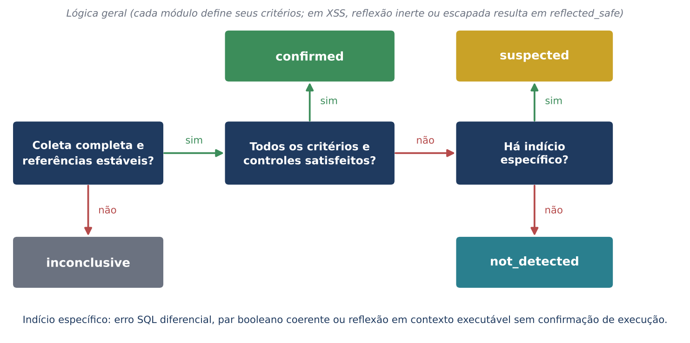

> Este documento reproduz seções do **relatório técnico** do trabalho (`RELATORIO_TECNICO.docx`). Referências do tipo "Seção N" apontam para as seções do relatório.

# 4. Modelo de detecção

## 4.1 Princípio: detecção diferencial com controles e abstenção

O ProbeKit não procura "assinaturas" de vulnerabilidade na resposta. Ele **compara respostas**: coleta referências estáveis, envia sondas de ataque e controles negativos, e só classifica como `confirmed` quando o comportamento observado é explicado pela vulnerabilidade e **não** pelos controles. A decisão é determinística, baseada em regras (não há aprendizado de máquina), e cada critério fica registrado no relatório (`checks`), de modo que a conclusão pode ser auditada. Quando faltam dados ou controles, a ferramenta se abstém (`suspected` ou `inconclusive`) em vez de arriscar um palpite.

| Classe | Quando ocorre |
| --- | --- |
| `confirmed` | todos os critérios do módulo foram satisfeitos, inclusive os controles negativos |
| `suspected` | há indício específico (erro SQL, par booleano coerente, reflexão em contexto executável), mas falta controle ou confirmação |
| `inconclusive` | coleta incompleta, referências instáveis, página de erro ou formato incompatível: não é possível concluir |
| `not_detected` | o plano executado não demonstrou a falha; **não** prova que ela não existe |
| `reflected_safe` | (XSS) a entrada é refletida, mas em contexto inerte ou com escape |

## 4.2 SQL Injection: plano de sondas e critérios

Para cada parâmetro GET testado, o ProbeKit envia `samples + 8` requisições (10 no padrão), alterando **somente** o valor do parâmetro e preservando os demais byte a byte. Seja `t` o valor de referência (por exemplo, `apple`):

| Papel | Valor enviado | Função |
| --- | --- | --- |
| `baseline_1..N` | `t` | referência e estabilidade da resposta |
| `quote` | `t'` | provoca erro SQL se a aspa chega à consulta |
| `escaped_quote` | `t''` | controle negativo: aspa escapada não deve mudar a lógica |
| `literal_control` | `t AND 17=17` | controle literal: sem aspa, não deve virar condição |
| `true_17` / `false_17` | `t%' AND (17=17) AND '%' LIKE '%` / `(17=18)` | primeiro par booleano (contexto LIKE) |
| `true_23` / `false_23` | idem com `23=23` / `23=24` | segundo par, replica o primeiro |
| `recovery` | `t` | a resposta volta à referência? |

No contexto `quoted` (igualdade entre aspas), os pares usam `t' AND (17=17) AND 'x'='x`. As respostas são reduzidas a características reproduzíveis: para JSON, o conjunto de identificadores (ou a forma canônica); para HTML e texto, o texto visível normalizado. Só se guardam *hashes* dessas características, nunca o conteúdo.

A classificação usa dez critérios: coleta completa; referência não vazia e estável; recuperação igual à referência; resposta vazia nos dois controles (aspa escapada e literal); respostas "falsas" estáveis; **erro SQL novo** na sonda com aspa (assinatura de SQLite/Sequelize, status ≥ 400 e controles válidos); e dois pares booleanos coerentes (condição verdadeira igual à referência, condição falsa vazia).

- `confirmed`: todos os critérios satisfeitos (os dois pares, os controles e o erro diferencial);
- `suspected`: há erro SQL diferencial **ou** algum par booleano coerente, mas faltam critérios;
- `inconclusive`: coleta incompleta, referência instável ou resposta inadequada (por exemplo, página de erro com HTTP 200);
- `not_detected`: tudo coletado com qualidade, mas sem demonstração da falha.

## 4.3 XSS refletido: marcadores, contexto e execução

Cada parâmetro recebe um marcador exclusivo (`WVX` mais 24 caracteres hexadecimais e uma letra por sonda). O modelo:

1. confirma que referências e a recuperação **não** contêm o marcador (controle limpo);
2. exige **duas reflexões independentes** do marcador (`marker_1` e `marker_2`);
3. identifica o contexto de cada reflexão com um analisador HTML (texto, atributo, atributo de evento, URL, `script`, CSS, comentário, JSON etc.) e avalia o escape de `<`, `>`, `&`, `"` e `'` numa sonda dedicada;
4. envia sondas com um *callback* JavaScript inofensivo (`globalThis.wvxss_...`) para os contextos HTML, atributo e *script* (aspas simples e duplas);
5. opcionalmente, **reexecuta as respostas em um navegador isolado** (replay local, CSP preservada, rede bloqueada) e observa se o callback dispara no documento principal.

`confirmed` exige reflexão em contexto potencialmente executável **e** execução observada no navegador, com o controle negativo sem execução. Sem navegador, o melhor resultado é `suspected`. Se não há reflexão nos dois marcadores, as cinco sondas de ataque são dispensadas e o resultado é `not_detected`.

## 4.4 Exposição de arquivos: referências e controles inexistentes

O catálogo é fechado: no máximo cinco caminhos (`.env`, `config.ini`, `backup.sql`, `config.ini.bak`, `.git/HEAD`) em um diretório-base escolhido explicitamente. Para cada arquivo, a ferramenta faz quatro requisições: dois **controles** com caminhos inexistentes, de nome aleatório (`/.probekit-missing-<hex>-<arquivo>`), e duas **referências** ao arquivo real. A análise procura assinaturas estruturais (atribuições `CHAVE=valor` com indicadores de credencial ou banco, `CREATE TABLE` e `INSERT INTO`, referência Git), descarta HTML, páginas de erro e documentos públicos (README, LICENSE) e compara com os controles para reconhecer *fallbacks*. `confirmed` exige HTTP 200 estável, estrutura compatível com o tipo esperado, ausência de HTML e diferença em relação aos caminhos inexistentes. Valores e chaves encontrados **nunca** são gravados.

## 4.5 Limitações do modelo atual

- SQLi: só GET, contexto textual entre aspas simples; não cobre contexto numérico, SQLi temporal (time-based), UNION, bancos além dos reconhecidos pelas assinaturas, nem escrita.
- XSS: só XSS refletido por GET; não cobre XSS armazenado, DOM XSS nem eventos que exigem interação; a confirmação depende de Node e Edge/Chrome instalados.
- Exposição: catálogo de cinco caminhos; confirma acesso e estrutura, não a validade dos segredos nem se o arquivo deveria ser público.
- Descoberta: HTML estático; em aplicações de página única (como o Juice Shop) enxerga pouco.
- Critérios e limiares são fixos e foram calibrados em um conjunto pequeno de laboratórios.

## 4.6 Como o modelo pode evoluir

| Horizonte | Evolução | Motivação |
| --- | --- | --- |
| Curto | Suporte a POST, JSON, cabeçalhos e cookies nas sondas | O enunciado sugere fuzzing de cabeçalhos e formulários; hoje só GET |
| Curto | SQLi em contexto numérico, UNION e temporal | Cobertura de técnicas que já são padrão em ferramentas como o sqlmap |
| Curto | XSS armazenado e DOM; mais perfis de exposição | Ampliar a cobertura sem alterar a lógica de classificação |
| Médio | Descoberta com JavaScript (navegador sem interface) | Aplicações de página única, como o Juice Shop, hoje ficam quase invisíveis |
| Médio | Calibrar critérios com mais dados e medir sensibilidade | Hoje os critérios são fixos e foram validados em poucos casos |
| Médio | Classificador estatístico sobre as características já extraídas (`sqli_features.py`), usado como camada adicional e **sem** substituir os controles | Reduzir abstenções (por exemplo, o caso X06) mantendo a explicabilidade |
| Longo | Saída em formato padronizado (por exemplo SARIF) e integração com CI e SIEM | O resumo `findings.json` já separa alertas de evidências |
| Longo | Comparação contínua com sqlmap e ZAP no mesmo conjunto de casos | Transformar a Seção 9 em teste de regressão de qualidade |
