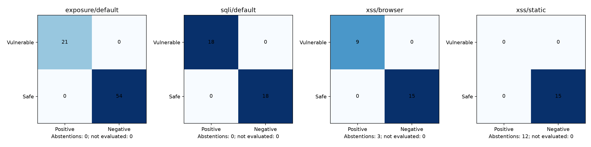
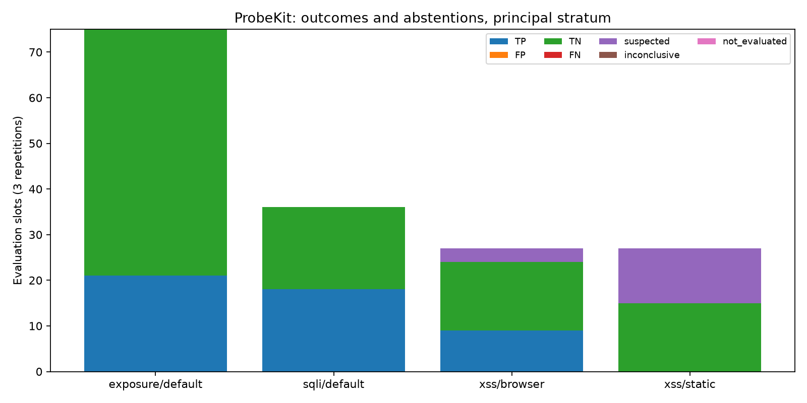
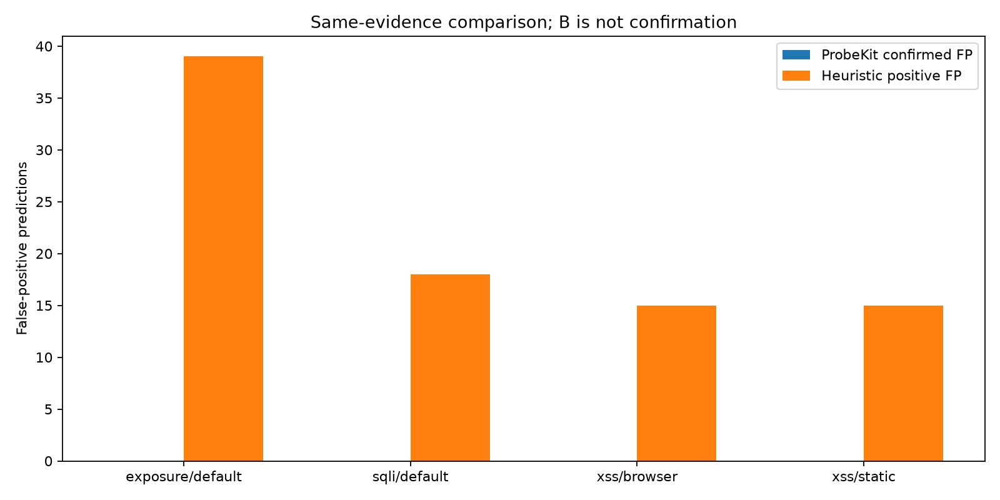
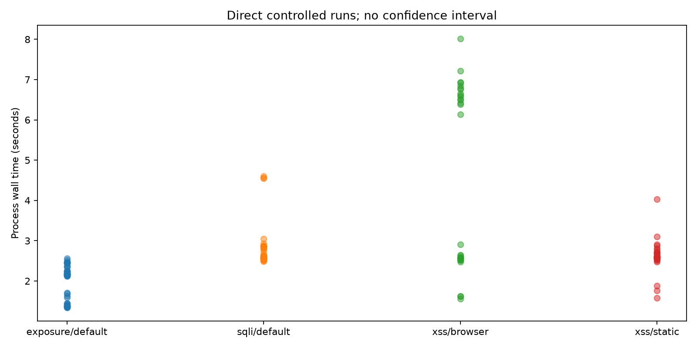

# ProbeKit — resultados experimentais PK-F3 v1.0.0

Campanha `05c7eb64-2f81-4ac6-bc83-9aa3048b8db5`; análise `dfde5155-4920-465b-bced-6b3ff7405a3e` (versão 1.0.3); produto 0.2.0; coletor 1.0.0.

## 1. Resumo da avaliação

Foram planejadas 165 execuções; 165 produziram evidência verificada. O scanner registrou 1761 GET; 0 execuções têm consumo desconhecido. As contagens seguintes são observações desta bateria, sem garantia universal.

Foram três rodadas: 156 execuções diretas (195 avaliações individuais), três
integradas controladas e seis no Juice Shop. A extração completa contém 252
linhas, incluindo os inventários integrados, que não entram novamente na matriz
principal. Não houve execução faltante nem retry experimental. Dos processos,
159 retornaram código 0; S12/S13 retornaram 1 nas seis avaliações inconclusivas.
Não houve erros inesperados de execução ou falhas de transporte dos detectores.
As três consultas
prévias de versão do Juice Shop são separadas dos 1.761 GET do scanner; o teto
pré-fixado era 2.040 GET. Tráfego da suíte automatizada fica fora dessa amostra.

## 2. Objetivos e hipóteses

O protocolo prévio avalia classificação, abstenção, cobertura e repetibilidade. A hipótese de benefício dos critérios diferenciais é comparada com uma heurística HTTP; a comparação não identifica causalmente o efeito isolado dos controles negativos.

## 3. Ambiente e versões

HEAD registrado: `2026e837c95552e40af365cb718dba577b9f8323` com alterações locais da Fase 2. O inventário SHA-256 contém o estado exato do código e dos testes. Python: 3.13.9 (main, Oct 28 2025, 12:03:59) [MSC v.1944 64 bit (AMD64)]; plataforma: win32; Node: v24.19.0; Edge: 157.0.4341.42. Requests: 2.34.2; Matplotlib: 3.11.2. O banco original do Juice Shop não foi usado: a execução usa clone do ZIP verificado.

As 58 alterações locais da Fase 2 já existiam na base; esta fase não as promoveu
a commit. A instalação de avaliação usa `.venv-evaluation`, lock com hashes e
wheels; `pip check` passou. O clone foi extraído do ZIP aprovado e seus 45.183
arquivos foram conferidos sem divergências antes de iniciar o Node. A conferência
final confirmou os hashes de 38 arquivos do núcleo, laboratórios, entrada da CLI
e scripts de navegador/loopback, além do banco original inalterado. Não restaram
escutas nas portas 3000, 8001 ou 8005.

## 4. Metodologia

Protocolo e catálogo foram registrados antes da coleta formal. Foram usados comandos existentes, três repetições, servidores controlados novos e originais restritos com ACL. Nenhum classificador, payload ou laboratório foi alterado. O gabarito deriva das implementações, não dos outcomes históricos. Não é estudo cego. As fórmulas e limitações estão em `protocol.md` no pacote. Cada unidade é um parâmetro ou arquivo, sem duplicar assessments agregados, findings ou checkpoints.

A fonte congelada da coleta consta em `source-state.json`; a fonte da análise
selecionada, em `analysis/analysis-source-state.json`. As correções posteriores
foram apenas na derivação: a análise 1.0.1 retirou os integrados do gráfico de
tempos por módulo; a 1.0.2 corrigiu as taxas de suspeita/inconclusividade do estrato
mitigado, antes calculadas incorretamente sobre as células binárias. A 1.0.3
fortaleceu a verificação dos vínculos campanha/análise/snapshot original e o
tratamento de snapshots parciais sem assessment. As versões
anteriores foram preservadas e estão identificadas como substituídas no
[índice de evidências](evidencias/fase3/README.md). As linhas extraídas, matrizes
binárias e métricas dos estratos não mitigados são idênticas entre 1.0.1 e 1.0.2.
Entre 1.0.2 e 1.0.3, todas as linhas e métricas, workflows e repetibilidade desta
campanha são idênticos.
Nenhum critério do protocolo, gabarito ou dado original foi alterado; não houve
nova coleta para essas correções.

## 5. Casos e gabarito

S01–S14 cobrem LIKE/quoted, JSON/HTML/texto, consultas concatenadas e parametrizadas, múltiplos parâmetros e diagnósticos. X01–X10 cobrem contextos executáveis, escape, MIME não executável, ausência de reflexão e CSP nas condições estática/browser. E01–E18 combinam seis diretórios e três perfis. `cases.json` contém unidades, justificativas, símbolos e hashes. CSP é mitigado, fora da matriz binária; diagnósticos e Juice não são incorporados à matriz principal.

## 6. Resultados SQLI

| Domínio/condição/estrato | Slots | TP | FP | TN | FN | Suspected | Inconclusive | Não avaliados | Precisão | Recall | Especificidade | FPR | Confirmação/vulneráveis planejados |
| --- | ---: | ---: | ---: | ---: | ---: | ---: | ---: | ---: | --- | --- | --- | --- | --- |
| controlled/default/diagnostic | 9 | 0 | 0 | 0 | 0 | 3 | 6 | 0 | N/D (0 no denominador) | N/D (0 no denominador) | N/D (0 no denominador) | N/D (0 no denominador) | 0.00% (0/3) |
| controlled/default/principal | 36 | 18 | 0 | 18 | 0 | 0 | 0 | 0 | 100.00% (18/18) | 100.00% (18/18) | 100.00% (18/18) | 0.00% (0/18) | 100.00% (18/18) |
| juice/default/application | 3 | 3 | 0 | 0 | 0 | 0 | 0 | 0 | 100.00% (3/3) | 100.00% (3/3) | N/D (0 no denominador) | N/D (0 no denominador) | 100.00% (3/3) |

Observação: S12 (instabilidade) e S13 (página de erro) foram inconclusivos nas
três repetições; S14 (contexto incompatível) permaneceu suspeito. Os checks não
satisfeitos estão registrados por unidade em `analysis/rows.json`, incluindo
estabilidade/recuperação nos inconclusivos e os dois pares booleanos em S14.
Esses resultados diagnósticos não foram convertidos em negativos.

## 7. Resultados XSS

| Domínio/condição/estrato | Slots | TP | FP | TN | FN | Suspected | Inconclusive | Não avaliados | Precisão | Recall | Especificidade | FPR | Confirmação/vulneráveis planejados |
| --- | ---: | ---: | ---: | ---: | ---: | ---: | ---: | ---: | --- | --- | --- | --- | --- |
| controlled/browser/principal | 27 | 9 | 0 | 15 | 0 | 3 | 0 | 0 | 100.00% (9/9) | 100.00% (9/9) | 100.00% (15/15) | 0.00% (0/15) | 100.00% (9/9) |
| controlled/static/principal | 27 | 0 | 0 | 15 | 0 | 12 | 0 | 0 | N/D (0 no denominador) | N/D (0 no denominador) | 100.00% (15/15) | 0.00% (0/15) | 0.00% (0/9) |

CSP é contado por outcome, sem atribuição binária. Navegador solicitado e confirmação são registros distintos.

| Condição CSP | Avaliações | Suspected | Inconclusive | Confirmed | Browser completed | Confirmações no navegador |
| --- | ---: | ---: | ---: | ---: | ---: | ---: |
| browser | 3 | 3 | 0 | 0 | 3 | 0 |
| static | 3 | 3 | 0 | 0 | 0 | 0 |

Observação: os nove slots vulneráveis principais ficaram suspeitos sem navegador
e foram confirmados com replay. X06, JavaScript corretamente escapado e com
gabarito seguro, ficou **suspeito nas três repetições de cada condição**. O replay
de X06 terminou, mas não observou execução. São seis suspeitas em caso seguro;
não são FP pela definição estrita de confirmação, nem evidência de comportamento
perfeito. X10/CSP também ficou suspeito em ambas as condições; os três replays
terminaram sem confirmação. Seu gabarito é mitigado e não foi forçado a seguro.

Interpretação: a precisão e o recall conclusivos do XSS estático são indefinidos;
o rendimento de confirmação é 0/9. A especificidade 15/15 usa apenas os seguros
com decisão negativa e exclui os três seguros suspeitos. Essas abstenções precisam
acompanhar qualquer apresentação das taxas.

## 8. Resultados EXPOSURE

| Domínio/condição/estrato | Slots | TP | FP | TN | FN | Suspected | Inconclusive | Não avaliados | Precisão | Recall | Especificidade | FPR | Confirmação/vulneráveis planejados |
| --- | ---: | ---: | ---: | ---: | ---: | ---: | ---: | ---: | --- | --- | --- | --- | --- |
| controlled/default/diagnostic | 15 | 0 | 0 | 15 | 0 | 0 | 0 | 0 | N/D (0 no denominador) | N/D (0 no denominador) | 100.00% (15/15) | 0.00% (0/15) | N/D (0 no denominador) |
| controlled/default/principal | 75 | 21 | 0 | 54 | 0 | 0 | 0 | 0 | 100.00% (21/21) | 100.00% (21/21) | 100.00% (54/54) | 0.00% (0/54) | 100.00% (21/21) |

Observação: os 21 slots vulneráveis principais foram confirmados, enquanto 54
seguros principais e 15 diagnósticos foram negativos. HTTP 200 em documentação,
fallback HTML ou erro personalizado não bastou para confirmar exposição.
Esses resultados dizem respeito aos artefatos fictícios do catálogo, sem inferir
validade de segredos ou persistir valores encontrados.

## 9. Matrizes, cobertura e abstenções

Negativos são not_detected e, somente para XSS, reflected_safe. Suspected e inconclusive não se tornam TP/TN. Sem avaliação utilizável é not_evaluated; integridade inválida impede o uso da evidência. Recall conclusivo pode ser N/D quando todas as vulnerabilidades ficam suspeitas; o rendimento sobre vulneráveis planejados revela essa ausência de confirmação.

| Grupo | Cobertura de unidades | Inconclusividade | Suspeitas |
| --- | --- | --- | --- |
| controlled/exposure/default/diagnostic | 100.00% (15/15) | 0.00% (0/15) | 0.00% (0/15) |
| controlled/exposure/default/principal | 100.00% (75/75) | 0.00% (0/75) | 0.00% (0/75) |
| controlled/sqli/default/diagnostic | 100.00% (9/9) | 66.67% (6/9) | 33.33% (3/9) |
| controlled/sqli/default/principal | 100.00% (36/36) | 0.00% (0/36) | 0.00% (0/36) |
| controlled/xss/browser/mitigated | 100.00% (3/3) | 0.00% (0/3) | 100.00% (3/3) |
| controlled/xss/browser/principal | 100.00% (27/27) | 0.00% (0/27) | 11.11% (3/27) |
| controlled/xss/static/mitigated | 100.00% (3/3) | 0.00% (0/3) | 100.00% (3/3) |
| controlled/xss/static/principal | 100.00% (27/27) | 0.00% (0/27) | 44.44% (12/27) |
| juice/sqli/default/application | 100.00% (3/3) | 0.00% (0/3) | 0.00% (0/3) |

Contagens principais por gabarito e outcome, incluindo as três repetições:

| Detector/condição | Gabarito | Confirmed | Not detected | Reflected safe | Suspected | Inconclusive | Not evaluated |
| --- | --- | ---: | ---: | ---: | ---: | ---: | ---: |
| SQLi/default | vulnerable | 18 | 0 | 0 | 0 | 0 | 0 |
| SQLi/default | safe | 0 | 18 | 0 | 0 | 0 | 0 |
| Exposure/default | vulnerable | 21 | 0 | 0 | 0 | 0 | 0 |
| Exposure/default | safe | 0 | 54 | 0 | 0 | 0 | 0 |
| XSS/static | vulnerable | 0 | 0 | 0 | 9 | 0 | 0 |
| XSS/static | safe | 0 | 3 | 12 | 3 | 0 | 0 |
| XSS/browser | vulnerable | 9 | 0 | 0 | 0 | 0 | 0 |
| XSS/browser | safe | 0 | 3 | 12 | 3 | 0 | 0 |

Cobertura de avaliações disponíveis não significa decisão conclusiva nem
cobertura percentual de uma aplicação. Não se calculou uma precisão universal.





## 10. Comparação com heurística simplificada

B compara status/tamanho/hash bruto com a primeira referência, na mesma evidência coletada. Não usa nome do caso, gabarito, URLs ou assessment; positive é predição, não confirmação. A interpretação deve considerar conjuntamente acertos, erros e abstenções.

| Grupo | Acertos A | FP A | FN A | Suspeitas/inconclusivos A | Acertos B | FP B | FN B | Inconclusivos B |
| --- | ---: | ---: | ---: | ---: | ---: | ---: | ---: | ---: |
| controlled/exposure/default/diagnostic | 15 | 0 | 0 | 0 | 0 | 15 | 0 | 0 |
| controlled/exposure/default/principal | 75 | 0 | 0 | 0 | 36 | 39 | 0 | 0 |
| controlled/sqli/default/diagnostic | 0 | 0 | 0 | 9 | 6 | 3 | 0 | 0 |
| controlled/sqli/default/principal | 36 | 0 | 0 | 0 | 18 | 18 | 0 | 0 |
| controlled/xss/browser/principal | 24 | 0 | 0 | 3 | 12 | 15 | 0 | 0 |
| controlled/xss/static/principal | 15 | 0 | 0 | 12 | 12 | 15 | 0 | 0 |
| juice/sqli/default/application | 3 | 0 | 0 | 0 | 3 | 0 | 0 | 0 |

Interpretação: na matriz principal B produziu 39 FP em Exposure, 18 em SQLi e 15
em cada condição XSS. A não produziu FP confirmados nessa amostra, mas reteve
suspeitas, inclusive em X06 seguro. A diferença é compatível com utilidade dos
critérios completos; não demonstra que somente os controles negativos causaram
a melhoria. A/B usam as mesmas unidades e respostas elegíveis. Todas essas
unidades tiveram dados suficientes para B; cobertura, taxas e denominadores de
ambos estão em `analysis/metrics.json`. B não representa um scanner comercial.



## 11. Juice Shop e integração

O Juice Shop 20.3.0 usa JavaScript. Estes números não medem cobertura integral da aplicação. J01 é descoberta automática com catálogo Exposure configurado; J02 é uma URL manual conhecida de busca. Ausência do endpoint conhecido na descoberta não é resultado negativo do detector.

| Caso/rep | Páginas | Endpoints | Parâmetros | Alvos | Arquivos configurados | Busca conhecida descoberta/analisada | GET | Tempo processo (s) |
| --- | ---: | ---: | ---: | ---: | ---: | --- | ---: | ---: |
| I01/1 | 6 | 6 | 4 | 13 | 5 | False/False | 96 | 20.05618000000686 |
| J01/1 | 1 | 1 | 0 | 5 | 5 | False/False | 21 | 4.78483419999975 |
| J02/1 | — | — | — | — | — | —/— | 10 | 2.5268321000039577 |
| I01/2 | 6 | 6 | 4 | 13 | 5 | False/False | 96 | 19.932107100001303 |
| J01/2 | 1 | 1 | 0 | 5 | 5 | False/False | 21 | 4.8293397999950685 |
| J02/2 | — | — | — | — | — | —/— | 10 | 2.566114399996877 |
| I01/3 | 6 | 6 | 4 | 13 | 5 | False/False | 96 | 20.029947200004244 |
| J01/3 | 1 | 1 | 0 | 5 | 5 | False/False | 21 | 4.996074399998179 |
| J02/3 | — | — | — | — | — | —/— | 10 | 2.685409099998651 |

Observação: em cada J01 foram visitados uma página e um endpoint, com zero
parâmetros identificados. Os cinco alvos analisados vieram do catálogo Exposure,
todos negativos; houve uma exclusão `no_query_parameters`. A busca conhecida não
foi descoberta nem analisada automaticamente. Em J02, fornecida manualmente,
SQLi foi confirmado 3/3, com dez GET por execução. Não houve limites atingidos.
A coleta foi concluída, mas a cobertura automática observada é estreita.

Em I01, cada rodada visitou seis páginas e avaliou 13 unidades com 96 GET:
três confirmações, oito negativos, uma reflexão segura e uma suspeita. Esses
inventários são evidência de integração, separados das unidades diretas.


I01/1: requisições por fase {'analysis': 90, 'discovery': 6}; por módulo {'discovery': 6, 'exposure': 20, 'sqli': 40, 'xss': 30}; estados {'completed': 13}; ignorados {'no_query_parameters': 2}; limites []; outcomes {'applicable': True, 'evaluations': 13, 'has_inconclusive': False, 'outcomes': {'confirmed': 3, 'inconclusive': 0, 'not_detected': 8, 'reflected_safe': 1, 'suspected': 1}}.


J01/1: requisições por fase {'analysis': 20, 'discovery': 1}; por módulo {'discovery': 1, 'exposure': 20}; estados {'completed': 5}; ignorados {'no_query_parameters': 1}; limites []; outcomes {'applicable': True, 'evaluations': 5, 'has_inconclusive': False, 'outcomes': {'confirmed': 0, 'inconclusive': 0, 'not_detected': 5, 'reflected_safe': 0, 'suspected': 0}}.


I01/2: requisições por fase {'analysis': 90, 'discovery': 6}; por módulo {'discovery': 6, 'exposure': 20, 'sqli': 40, 'xss': 30}; estados {'completed': 13}; ignorados {'no_query_parameters': 2}; limites []; outcomes {'applicable': True, 'evaluations': 13, 'has_inconclusive': False, 'outcomes': {'confirmed': 3, 'inconclusive': 0, 'not_detected': 8, 'reflected_safe': 1, 'suspected': 1}}.


J01/2: requisições por fase {'analysis': 20, 'discovery': 1}; por módulo {'discovery': 1, 'exposure': 20}; estados {'completed': 5}; ignorados {'no_query_parameters': 1}; limites []; outcomes {'applicable': True, 'evaluations': 5, 'has_inconclusive': False, 'outcomes': {'confirmed': 0, 'inconclusive': 0, 'not_detected': 5, 'reflected_safe': 0, 'suspected': 0}}.


I01/3: requisições por fase {'analysis': 90, 'discovery': 6}; por módulo {'discovery': 6, 'exposure': 20, 'sqli': 40, 'xss': 30}; estados {'completed': 13}; ignorados {'no_query_parameters': 2}; limites []; outcomes {'applicable': True, 'evaluations': 13, 'has_inconclusive': False, 'outcomes': {'confirmed': 3, 'inconclusive': 0, 'not_detected': 8, 'reflected_safe': 1, 'suspected': 1}}.


J01/3: requisições por fase {'analysis': 20, 'discovery': 1}; por módulo {'discovery': 1, 'exposure': 20}; estados {'completed': 5}; ignorados {'no_query_parameters': 1}; limites []; outcomes {'applicable': True, 'evaluations': 5, 'has_inconclusive': False, 'outcomes': {'confirmed': 0, 'inconclusive': 0, 'not_detected': 5, 'reflected_safe': 0, 'suspected': 0}}.


## 12. Repetibilidade

84/84 combinações unidade/condição tiveram as três avaliações disponíveis e idênticas. O arquivo repeatability.json mostra frequências, ausências, mínimo/mediana/máximo e desvio amostral. Marcadores, timestamps e portas variam por construção; hashes diferentes entre repetições não provam instabilidade. Não foram calculados intervalos de confiança ou significância com n=3.

Consistência não implica correção: as suspeitas em X06 e os inconclusivos SQLi
também se repetiram. O gráfico abaixo usa um ponto por processo direto, sem
duplicar durações de unidades que compartilharam a mesma execução. Os tempos
de integração/aplicação estão na tabela anterior e em `workflows.json`; a duração
indicada pelo scanner fica separada da duração monotônica de processo.



## 13. Limitações e ameaças à validade

Conjunto sintético e pequeno, configurações/repetições correlacionadas, conhecimento histórico e um único ambiente. A heurística não representa ZAP/Burp e difere em vários critérios. Exposure confirma estrutura de artefatos fictícios, não validade de segredos. Tempos incluem subprocesso, worker, navegador quando solicitado e gravação; caches do SO podem variar. A descoberta estática não executa JavaScript. Matrizes de diagnóstico/mitigado não substituem a principal. Hashes comprovam correspondência, não assinatura/autenticidade contra substituição de todo o pacote.

A saída textual dos subprocessos foi descartada, sem arquivar stdout/stderr
brutos. Foram preservados os códigos de retorno, tempos, metadados, checks e
relatórios verificados. Isso limita diagnóstico textual retrospectivo, sem
substituir avaliações ausentes por inferências. O pacote público não inclui
originais restritos nem o clone; seu catálogo contém rotas relativas e entradas
fictícias da definição do experimento, enquanto evidências/tabelas omitem URLs
operacionais, payloads e caminhos pessoais. A anonimização não é assinatura nem
promessa de anonimato absoluto.

## 14. Conclusões fundamentadas

**O que os dados sustentam.** Nas unidades e configurações registradas (165 execuções, três repetições, 84 de 84 combinações idênticas), o ProbeKit confirmou 18 de 18 slots de SQLi vulneráveis e 21 de 21 de exposição, e não produziu falso positivo confirmado em nenhum caso seguro (18 de SQLi, 54 de exposição, 15 de XSS e os diagnósticos). Em XSS a confirmação depende de prova de execução: com navegador, 9 de 9 vulneráveis foram confirmados; sem navegador, os 9 permaneceram `suspected` (0 de 9). Sobre a mesma evidência, a heurística B produziu 39 FP em exposição, 18 em SQLi e 15 em cada condição de XSS.

**O que isso custa.** O conservadorismo tem preço declarado: abstenções (S12 e S13 `inconclusive`; S14 `suspected`), seis suspeitas em caso seguro (X06, nas duas condições), o caso com CSP (X10) `suspected` sem execução observada e cobertura automática estreita no Juice Shop (J01 descobriu 0 parâmetros; com a URL informada, J02 confirmou 3 de 3).

**O que não se pode concluir.** Os resultados descrevem o comportamento nas unidades registradas; não medem a segurança de aplicações reais, não se generalizam para outros bancos, contextos ou frameworks, e `not_detected` nunca equivale a ausência de vulnerabilidade. O conjunto é sintético e pequeno, o gabarito vem das implementações e a heurística B não representa scanners como sqlmap ou ZAP (ver [comparação com ferramentas](COMPARACAO_FERRAMENTAS.md)).

**Como apresentar.** O grau de confirmação, suspeita e abstenção deve acompanhar sempre as taxas conclusivas. A aplicação complexa mostra a cobertura observada e o efeito de fornecer a URL manual; não certifica a segurança da aplicação. Impacto, mitigação e evolução estão em [impacto e mitigação](IMPACTO_E_MITIGACAO.md) e [modelo de detecção](MODELO_DE_DETECCAO.md); o roteiro de apresentação está em [ROTEIRO_APRESENTACAO.md](ROTEIRO_APRESENTACAO.md).

## 15. Reprodução, artefatos e testes

Usar Python/locks e estado de código registrados. Os comandos prepare/run/analyze/export/verify são descritos no README do avaliador. Cada campanha/análise usa UUID novo e não sobrescreve dados. O pacote público permite recalcular as métricas e B sem acesso aos originais restritos.

Pacote: `docs/evidencias/fase3/05c7eb64-2f81-4ac6-bc83-9aa3048b8db5-dfde5155-4920-465b-bced-6b3ff7405a3e`.

Originais privados e análises preservadas:
`reports/evaluation/05c7eb64-2f81-4ac6-bc83-9aa3048b8db5/`. Entradas e comandos:
[README do avaliador](../experiments/evaluation/README.md). O
[índice do pacote](evidencias/fase3/README.md) identifica a análise vigente.

```powershell
.\.venv-evaluation\Scripts\python.exe -m experiments.evaluation.run_evaluation verify docs/evidencias/fase3/05c7eb64-2f81-4ac6-bc83-9aa3048b8db5-dfde5155-4920-465b-bced-6b3ff7405a3e
.\.venv-evaluation\Scripts\python.exe -m pytest -q
.\.venv-evaluation\Scripts\python.exe -m pip check
```

Suíte anterior: 543 aprovados; 0 falhos; 0 erros; 0 ignorados; 192.864 s.
Testes novos intermediários (análise 1.0.2): 30 aprovados; 0 falhos; 0 erros; 0 ignorados; 8.545 s.
Suíte intermediária (análise 1.0.2): 573 aprovados; 0 falhos; 0 erros; 0 ignorados; 200.889 s.

Fechamento da análise 1.0.3: **35 testes novos aprovados em 20,64 s**;
**578 aprovados na suíte completa em 210,64 s**, com zero falhos, erros,
ignorados ou não executados. Os oito casos existentes de navegador real rodaram.
`pip check` e `git diff --check` passaram. O comando CLI `verify` confirmou o
pacote selecionado. Nenhum experimento formal foi repetido para corrigir o avaliador.

As durações acima são dos JUnit; o pytest informou 192,94 s na referência,
8,61 s nos 30 testes novos e 200,99 s na suíte intermediária. Não houve testes não
executados: os oito casos existentes de navegador rodaram. Os 75 testes
relacionados também passaram em 16,95 s. Todos os novos casos são de avaliação;
os testes antigos não foram ajustados nesta fase. Registros em
`reports/phase3-before.xml`, `phase3-accepted-new.xml`,
`phase3-related.xml` e `phase3-accepted-all.xml`. O fechamento da análise 1.0.3 usa
`phase3-release-new.xml` e `phase3-release-all.xml`.

Uma regressão de derivação falhou inicialmente (taxa do estrato mitigado,
`reports/phase3-mitigated-before.xml`); após a correção passou. Três regressões
adicionais reproduziram a falta de vínculo entre IDs em pacotes recompostos
(`phase3-identity-before.xml`); duas reproduziram o tratamento inadequado de
assessment ausente (`phase3-partial-before.xml`, com um caso inconclusivo aprovado).
Esses problemas do avaliador foram corrigidos, sem alterar evidências do scanner.
As execuções intermediárias aprovadas e as duas correções estão no
[acompanhamento](FASE3_ACOMPANHAMENTO.md). Fixtures de testes não integram a amostra.

Execuções não avaliadas/sem evidência verificada: [].

Figuras derivadas: outcomes, matrices, comparison e timings (PNG/SVG em analysis/figures). Os históricos da Fase 2 e os testes com fixtures não foram incorporados às observações desta campanha. Não houve commit, push, tag ou publicação automática.

A verificação final conferiu os 165 pares de relatórios e 1.011 arquivos selados
(7.936.594 bytes incluindo o selo). A auditoria dos campos de evidência não
encontrou corpos, cookies, autenticação, payloads ou sentinelas proibidas.
Uma reprodução offline, com HTTP bloqueado, recalculou as três tabelas e oito
figuras usando somente o pacote público: **11/11 arquivos idênticos byte a byte**.
Registro privado da análise 1.0.3:
`reports/phase3-reproduction/d15f1448-7634-4b4d-83ea-cd0719dfdf0c/verification.json`;
auditoria: `reports/phase3-release-audit.json`. Além do subconjunto de 38 arquivos,
foram comparadas todas as 78 fontes pré-existentes inventariadas fora do avaliador
e de seu novo teste: nenhuma mudou. Os comandos não publicam artefatos.
